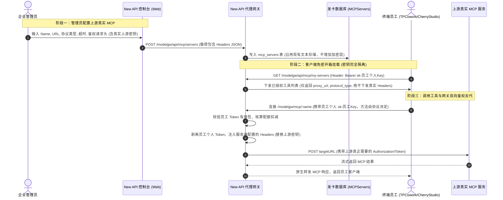

# 0005：MCP 上游鉴权密钥、协议类型与超时控制需求规格说明书

## 状态与元数据

- **状态**：方案已对齐（草案批准），待实施
- **对应决策**：A-A-A（CherryStudio 风格轻量多行请求头输入、扩展协议类型与超时、上游密钥安全掩码脱敏）
- **关联模块**：`mcp/` (Go 后端数据模型、反向代理与控制器)、`web/src/features/mcp/` (前端 MCP 服务管理对话框与表格)

---

## 一、背景与问题

### 1.1 核心痛点
1. **上游第三方 MCP 密钥无法配置**：目前大量生产级内网或商业 MCP 服务（如高德地图、同花顺 iFinD、自研企业知识库等）要求在请求头中携带上游系统的 API 密钥（如 `Authorization: Bearer <upstream_token>`、`X-API-Key: <token>` 等）。当前后台仅有 `BaseURL`，缺乏配置并注入该密钥的入口。
2. **数据库字段存在但更新丢失**：`mcp/model.go` 的 `MCPServer` 结构体中虽定义了 `Headers string` 字段，但在 `Update()` 方法的 `Select(...)` 显式投影中遗漏了 `headers`，导致既有数据无法正常持久化更新。
3. **协议类型未显式区分**：Cherry Studio 及现代协同客户端支持 `sse`（Server-Sent Events）与 `streamableHttp` 等多种 HTTP 流式通信标准。当前网关未暴露协议标识，客户端挂载时缺乏协议协商依据。
4. **长耗时分析与复杂检索容易超时**：金融研报、数据库宽表查询等重量级 MCP 工具调用耗时较长，网关缺乏针对单服务的超时（Timeout）配置，默认配置可能引发过早断连。

### 1.2 参考架构（Cherry Studio 交互形态）
参考主流客户端 Cherry Studio 的 MCP 服务器配置视图：
- **类型**：可流式传输的 HTTP (`streamableHttp`) / SSE (`sse`)
- **请求头**：轻量级多行键值对文本框（`Header: Value` 或 `Header=Value`，多行输入，支持一键示例）
- **超时**：超时时长（秒）

---

## 二、架构与契约设计

### 2.1 整体数据流与安全隔离机制



**安全底线**：上游第三方真实密钥仅保存在 New API 网关服务端，对外完全遮蔽；下发给员工客户端的只是网关代理地址和协议类型，员工电脑绝不接触上游真实凭据。

---

## 三、详细设计规格

### 3.1 数据库与模型契约 (`mcp/model.go`)

在 `MCPServer` 结构体中扩展协议与超时属性：

```go
type MCPServer struct {
	Id           int            `json:"id" gorm:"primaryKey;autoIncrement"`
	Name         string         `json:"name" gorm:"type:varchar(64);uniqueIndex;not null"`
	DisplayName  string         `json:"display_name" gorm:"type:varchar(128);not null"`
	Description  string         `json:"description" gorm:"type:text"`
	BaseURL      string         `json:"base_url" gorm:"type:varchar(512);not null"`
	Headers      string         `json:"headers" gorm:"type:text"` // JSON 字符串: {"Authorization":"Bearer xxx"}
	ProtocolType string         `json:"protocol_type" gorm:"type:varchar(32);default:'sse'"` // sse / streamableHttp
	Timeout      int            `json:"timeout" gorm:"type:int;default:60"` // 超时时间（秒），默认 60
	Status       int            `json:"status" gorm:"type:int;default:1;index"`
	QuotaPerCall int            `json:"quota_per_call" gorm:"type:int;default:0"`
	CreatedAt    int64          `json:"created_at" gorm:"autoCreateTime"`
	UpdatedAt    int64          `json:"updated_at" gorm:"autoUpdateTime"`
	DeletedAt    gorm.DeletedAt `json:"-" gorm:"index"`
}
```

- **更新投影补齐**：
  修改 `(server *MCPServer) Update()`，将 `"headers"`, `"protocol_type"`, `"timeout"` 加入 GORM 的 `Select(...)` 列表：
  ```go
  return model.DB.Model(server).Select(
      "name", "display_name", "description", "base_url",
      "headers", "protocol_type", "timeout", "status", "quota_per_call",
  ).Updates(server).Error
  ```

### 3.2 敏感密钥保护与编辑规则

1. 所有管理端列表、详情、创建及更新响应均不得返回已保存的敏感 Header 原值；不提供明文取回接口。普通客户端不得取得任何上游 Headers。
2. 编辑操作明确区分保留、替换、删除，不通过 Value 是否包含 `****` 猜测操作。未修改的密钥保留原值，删除与空值的含义不得混用。
3. 眼睛按钮只控制本次新输入内容的显示，不会取回已保存密钥。固定掩码仅用于展示，不作为实际凭据提交。
4. 本期沿用现有数据库文本存储，不新增加密主密钥或加密迁移；数据库及备份可能含明文。请求头和 URL 查询参数中的凭据不得进入日志、错误响应或普通客户端；旧 SSE 后续地址改写不得泄露查询凭据。

### 3.3 反向代理层改造 (`mcp/proxy.go`)

1. **针对性超时控制**：
   - 提取 `server.Timeout`（若 `<= 0` 则回退默认 60 秒）；
   - 配置 `ResponseHeaderTimeout`，仅限制等待上游响应头，不为整个流设置相同的总时限；正常 SSE 不在 60 秒后被强制断开。客户端断开时取消上游请求。本期不新增流空闲超时。
2. **动态请求头注入**：
   - 保持原有解析逻辑，将 `server.Headers`（JSON 字符串）解析为字典并遍历执行 `req.Header.Set(k, v)`；
   - 无论是否配置上游鉴权，均先剥离员工网关鉴权信息和浏览器 Cookie，再注入上游配置。Host 使用目标地址，不能仅用普通 Header.Set 改写；拒绝非法 Header 名称、换行值和影响 HTTP 传输的保留头，不把员工 Key 当作上游默认凭据。

3. **完整端点与协议行为**：
   - `BaseURL` 是完整 HTTP/HTTPS 上游端点，保留其配置的路径和查询，不自动追加 `/sse`。统一对外入口为 `/modelgw/mcp/:name`，不增加旧 `/sse` 入口兼容逻辑。
   - `protocol_type` 支持 `sse`、`streamableHttp`，不能仅增加标签便宣称协议可用。Streamable HTTP 验证初始化、会话头及后续请求；旧 SSE 的 endpoint 事件必须改写为仍经鉴权的网关消息地址，不得让客户端直连上游或携带上游密钥。
   - 后续地址只能绑定当前已配置服务，不能让客户端通过路径或地址参数指定任意目标。保留现有角色授权和计费规则，不借此调整计费模型。

### 3.4 客户端自查接口扩展 (`mcp/controller.go`)

在 `MCPAvailableItem` 结构体中新增协议类型字段：

```go
type MCPAvailableItem struct {
	Name         string `json:"name"`
	DisplayName  string `json:"display_name"`
	Description  string `json:"description"`
	ProxyURL     string `json:"proxy_url"`
	ProtocolType string `json:"protocol_type"` // "sse" | "streamableHttp"
	QuotaPerCall int    `json:"quota_per_call"`
}
```
保证 SkillHub Server 与 TPCowork 等下游系统能够获知上游期望的流式传输协议。

### 3.5 前端管理交互 (`web/src/features/mcp/`)

在 `MCPServerDialog` 中增设对应表单项：
1. **协议类型选择器 (`protocol_type`)**：
   - 单选下拉：`Server-Sent Events (sse)`（默认）/ `可流式传输的 HTTP (streamableHttp)`。
2. **超时时间输入框 (`timeout`)**：
   - 数字输入，单位“秒”，占位符 `60`。
3. **请求头多行文本框 (`headers`)**：
   - 采用 Cherry Studio 风格的多行文本编辑器；
   - 支持格式：
     - `Header-Name: Value`（如 `Authorization: Bearer sk-xxxx`）
     - `Header-Name=Value`（如 `X-API-Key=abcdef`）
     - 标准 JSON 字符串格式（粘贴自动识别）
   - 提供辅助功能：
     - **一键插入示例**（如“+ 插入 Bearer 认证示例”）；
     - **实时语法解析与格式校验**（提示格式是否有效）；
     - **本次输入的隐藏/显示按钮**（小眼睛图标），不得展示已保存密钥。

---

## 四、共同理解摘要 (Summary of Shared Understanding)

- **目标**：为 New API 后台引入对标 Cherry Studio 交互体验的 MCP 上游鉴权头、流式传输协议与超时管理，实现企业级上游密钥安全托管与透明代理。
- **最终成果**：
  1. `mcp/model.go`：新增 `ProtocolType`、`Timeout` 字段，修复 `Update()` 丢字段问题，完善敏感数据脱敏；
  2. `mcp/proxy.go`：反向代理支持自定义响应头等待超时并持续注入上游 Header；
  3. `mcp/controller.go`：自查接口向客户端透传 `protocol_type`；
  4. `web/` 前端：提供多行请求头解析编辑框、协议下拉列表与超时输入。
- **用户把控点**：密钥填写体验自由（换行/等号/冒号/JSON 均可）、本次新输入的密钥可隐藏或显示、已保存密钥可保留/替换/删除、响应头等待超时支持自定义。
- **明确不做的内容**：
  - 不支持 `stdio` 协议（网关为中心化 HTTP 服务，stdio 为客户端本地进程，不纳入网关反代范围）；
  - 绝对不将上游真实密钥下发至普通员工的终端电脑或下游中台。
- **验收标准**：
  1. 后台成功创建带有 `Authorization: Bearer secret_123` 的 MCP 服务，刷新与编辑时不丢字段；
  2. 编辑二次保存未修改密钥时，脱敏掩码不会破坏数据库底层密钥；
  3. 客户端自查接口 `/modelgw/api/mcp/my-servers` 成功返回带 `protocol_type` 的条目；
  4. 携带员工个人 Key 访问网关反代端点，上游真实服务能够接收到注入的 `secret_123`。

## 五、实施与验证顺序

1. 扩展现有 MCP 数据模型及管理契约，复用现有 JSON、响应包装与数据库访问；修复 Headers 更新，并验证保留、替换、删除及所有响应不泄密。
2. 在现有反向代理内实现完整端点映射、凭据剥离、配置注入及响应头等待超时，补齐两种协议的后续请求处理，不引入协议转换框架。
3. 扩展现有 MCP 弹窗、类型与表格，复用项目表单和组件；多行输入仅在前端转换为规范 JSON，后端独立验证。重复 Header 名称按大小写不敏感检测并报错，JSON 只接受字符串值，空输入表示无请求头。
4. 在独立 SQLite、MySQL、PostgreSQL 上验证新建及旧结构升级、数据保留和两次启动的幂等性；记录具体版本及命令，不连接现有业务库进行迁移试验。
5. 使用本地可控 MCP 上游验证两种协议、注入及隔离、超时、客户端取消；扩展现有 `mcp/mcp_test.go`，不分散重复测试。前端验证解析与密钥编辑操作、类型检查、涉及文件 lint、构建以及实际浏览器保存/刷新/再次编辑流程。
6. 默认不调用真实收费 MCP、不改第三方凭据，不自动部署本需求到现有 Docker；交付时列明尚未通过的验收项。正常长连接超过配置等待时长仍可用，超时返回与取消无敏感日志，均须有直接证据。

以上语义已在本次会话逐项获得用户确认；实施中若发现必须改变这些契约，应先说明具体影响。


## 六、已落实的接口约定与运行边界

- 管理接口返回的 `headers` 为 JSON 字符串，仅含名称及 `null`，所有已保存值均不回传。更新时不传整个 `headers` 表示全部保留；传入对象中的 `null` 表示保留该名称现值，字符串表示替换（包括字面量 `****`），遗漏的名称删除，`{}` 删除全部。创建不允许用 `null` 引用不存在的值。
- 管理接口隐藏 BaseURL 查询参数，返回 `has_url_query`；编辑时 URL 未变则前端不提交该字段，后端保留完整地址。填写新地址表示完整替换，也可据此删除原查询参数。不按掩码猜测操作。
- 超时范围 1–86400 秒，默认 60 秒；仅作用于响应头等待。协议枚举为 `sse` / `streamableHttp`，外部入口固定 `/modelgw/mcp/:name`，不提供旧 `/sse` 入口兼容。
- 旧 SSE endpoint 仅接受与配置地址同源的目标，并转换为绑定服务、当前 Token 和配置地址的临时句柄；流结束或取消时清理。句柄保存在当前进程内，多副本部署需确保 SSE 及其 POST 请求命中同一实例；本期不增加分布式会话存储。单事件上限 4 MiB。
- 请求剥离网关 Authorization、Cookie、其他受支持的 API Key 入口与 X-Auth-Session 后再注入配置；上游重定向被拒绝，Set-Cookie 不透传。旧 SSE 请求使用 identity 编码以便安全改写事件。包含配置凭据的写入不输出 SQL 日志，即使开启 DEBUG。
- 复用项目 Dialog、表单、NativeSelect、Textarea、Button、CopyButton 及 JSON/响应包装。既有单行 PasswordInput 不支持多行格式、已保存名称列表和显式删除，因此以现有组件组合 MCP 专用编辑区，没有新增通用 UI 框架。

## 七、验证记录（2026-11-14）

以下为部署前的独立环境验证记录，使用 Go 1.26.10、Bun/Vitest 及独立 Docker 数据库；该阶段未连接或迁移 5175 业务数据库，未调用真实收费上游。后续经用户授权，基础功能已更新至 5175 应用容器，保留原数据库与挂载；部署前已备份，部署后原有用户、密钥、渠道及 MCP 配置数量保持不变。第八节新增功能尚未实现或部署。

| 检查 | 命令/方式 | 结果 |
| --- | --- | --- |
| MCP 后端回归 | `docker exec mcp05-build go test ./mcp -count=1 -v` | 10 项通过；含密钥保留/替换/删除、配置校验、权限目录、两种协议、无配置凭据剥离、跨源 endpoint 拒绝、超时与取消 |
| SQLite 3.50.4 | 上述命令内的 `TestMCPDatabaseMigration` | 全新结构及旧 MCP 结构升级，各执行 AutoMigrate 两次，校验原值、默认值、唯一索引和增改删；启用预处理语句 |
| MySQL 5.7.44 | `docker exec -e MCP_TEST_DIALECT=mysql -e MCP_TEST_DSN=<独立测试DSN> mcp05-build go test ./mcp -run TestMCPDatabaseMigration -count=1 -v` | 同上，通过 |
| PostgreSQL 15.19 | `docker exec -e MCP_TEST_DIALECT=postgres -e MCP_TEST_DSN=<独立测试DSN> mcp05-build go test ./mcp -run TestMCPDatabaseMigration -count=1 -v` | 同上，通过；未使用依赖更高版本的 SQL 特性，未实测最低 9.6 |
| 前端单测 | `bun run test -- src/features/mcp/headers.test.ts src/features/mcp/components/mcp-server-dialog.test.tsx`（web 下） | 6 项通过，含实际编辑表单提交及转义 JSON |
| 前端 lint | `bun x oxlint -c .oxlintrc.json` 加本次 MCP TS/TSX 文件列表 | 无错误 |
| 构建 | web 下 `bun run build`；`docker exec mcp05-build go build -o /build/.local-tests/modelgw/mcp05-new-api .` | 前后端构建通过 |
| 全项目类型检查 | web 下 `bun x tsc -b --pretty false` | 未通过：现有未修改文件仍有 31 个类型错误，含 mcp-role-dialog；本次新增和修改的文件无诊断，不能宣称全项目类型检查通过 |
| 浏览器 | 内置 Browser，独立 `http://localhost:5188/modelgw/mcp` | 创建、刷新、未修改再保存、替换字面星号值、删除单个 Header、语法报错通过；只读查询独立 SQLite 验证真实保存值及隐藏查询仍在；浏览器控制台无 error |

安全参考：OWASP Authentication、Session Management、Secrets Management Cheat Sheets；验证重点为服务端权限路径、员工凭据隔离、保存密钥不回传及错误不回显配置。本次未改动登录协议、会话轮换或密码机制，不作全系统 ASVS 合规声明。

验收截图与测试日志在 Git 忽略目录 `.local-tests/mcp05/`，构建及类型检查日志和本次可再生成 Go 二进制在 `.local-tests/modelgw/mcp05-*`。它们仅用于本地验收，交付后可删除；数据库与构建临时容器在验证完成后清理。工作区原有 AGENTS.md、CLAUDE.md 的修改未纳入本需求。

收尾：最终前端构建完成后已顺序重跑 Go 构建并通过；测试临时容器 mcp05-web、mcp05-mysql、mcp05-postgres、mcp05-build 已清理。保留的本次可执行文件约 154 MiB；日志、截图及独立 SQLite 数据合计约 1 MiB，可在不再复查时删除。本次未修改 relaykit/tokenkit 模块或共享日志数据库结构。


## 八、补充需求：测试连接与查看工具（已实现，未部署）

### 8.1 目标及范围

管理员配置 MCP 服务后，应能像 Cherry Studio 一样判断连接是否成功，并查看该服务实际提供的工具。当前“已启用”仅表示允许代理流量，不代表连接正常；不得把开关状态当作健康检查结果。

保持最小实现：在现有 MCP 服务操作中增加“测试连接”和“查看工具”，复用现有配置、协议处理、鉴权头注入、响应包装和弹窗组件。不新增数据库字段、历史兼容层、后台轮询或持久健康状态；不扩展 prompts、resources、工具执行、工具开关和完整调试日志系统。

### 8.2 操作与展示

1. 仅对已保存服务执行检查，使用后端保存的完整 URL、Headers、协议与超时配置。新建或修改配置后须先保存再测试，界面明确提示，不暗中保存草稿或把未保存输入当作已生效配置。
2. “测试连接”显示进行中、成功或失败；完成后展示本次检查时间、耗时以及成功的协商协议版本。成功定义为完成 MCP `initialize`、校验有效 JSON-RPC 初始化响应并发送 `notifications/initialized`，不是 TCP 可达、HTTP 200 或 SSE 连接建立即可。
3. “查看工具”在同一操作中完成初始化并调用 `tools/list`，展示工具总数、名称、说明及可展开的 `inputSchema` 参数 JSON，支持手动刷新。遵循服务返回的分页 cursor 读取后续页；未完整获取时必须明确标示，不得把首屏条目数称为总数。
4. 成功返回空工具列表时显示“连接成功，暂无工具”；上游不声明 tools 能力时显示“连接成功，服务未声明工具能力”。初始化成功但 `tools/list` 失败时分别展示“连接成功”和“工具获取失败”，不得将其当作空列表或连接失败。
5. 失败后仍可查看脱敏错误并重试；不伪造工具列表。上次成功结果若保留在当前弹窗，应明确标为旧结果和对应检查时间，不能伪装成本次结果。关闭弹窗或切换服务后清空本次检查状态。
6. 加载时禁止重复提交，允许取消；刷新使用最新已保存配置。新增用户文案同步项目七种语言，复用已有加载、空状态、错误状态及 JSON 展示组件。

### 8.3 后端及协议契约

- 在现有 `/modelgw/api/mcp/servers/:id` 管理路由下提供按服务 ID 发起的管理员检查接口；采用 POST 显式触发上游通信，最终子路径随实现确定。不接受浏览器传入任意目标 URL 或明文已保存密钥，不增加取密钥接口。
- 两个操作共享初始化与会话生命周期逻辑；不分别复制 SSE、HTTP 或 Header 处理。先检索现有依赖和公共能力，优先复用；只有诊断握手确有必要的差异才新增代码，不建立通用协议转换框架。
- SSE 和 Streamable HTTP 均须完成真实 MCP 握手及请求 ID 匹配。SSE 后续消息地址遵循已确认的同源限制；Streamable HTTP 保留协商版本、会话头并正确处理 JSON/SSE 响应。会话仅用于本次检查，结束、失败或取消均清理连接；支持会话终止的上游按协议清理。
- 沿用 `timeout` 作为响应头等待限制；另以共享常量明确本次诊断的总期限，防止上游已返回响应头但永不返回初始化或工具结果时挂起。该总期限只用于有限诊断操作，不改变正常代理 SSE 的长连接语义。分页循环、工具结果大小和数量须有明确共享上限；遇到上限或重复 cursor 时显示未完成原因，不静默截断或无限请求。
- 返回本次检查结果、耗时、协商版本以及必要工具元数据；错误按连接、鉴权、初始化、工具获取阶段区分，提供可读原因，并在适用时附上游 HTTP 状态码或 JSON-RPC 错误码。禁止直接回传原始响应体、完整目标 URL 查询、请求头或底层异常；上游错误文本和工具元数据均视为不可信内容，展示前避免凭据泄漏和 HTML 执行。
- 使用现有管理员鉴权，普通员工无权调用；员工 Authorization、Cookie、X-Auth-Session 等不得传给上游，仅注入保存的上游鉴权信息。不因诊断而放宽重定向、同源或保留请求头规则。
- 检查仅执行初始化、能力发现和 `tools/list`，不自动调用 `tools/call`，不扣减网关用户或 Token 的工具调用配额；第三方可能对连接或列表查询计费，测试使用本地可控上游，不自动验证内置真实服务或批量发起外部检查。诊断通过只证明该配置当时可连接及发现工具，不代表所有员工角色授权、余额或实际工具执行均通过。

### 8.4 验收与测试

1. 使用本地可控 SSE、Streamable HTTP 上游分别验证握手、已保存鉴权头注入、会话后续请求、工具名称/说明/参数展示及手动刷新；测试不得调用真实收费工具。
2. 覆盖错误凭据、网络失败、响应头超时、响应头已到但协议结果超时、非法初始化响应、工具列表 JSON-RPC 错误；界面展示正确失败阶段且不泄露配置密钥或查询参数。
3. 区分零工具、未声明 tools 能力、初始化成功但工具获取失败；验证多页列表、重复 cursor 和结果上限的明确提示。
4. 验证普通用户调用被拒绝、员工凭据不出站、取消及关闭时清理连接；重复点击不产生并发检查，切换服务不会串用结果。
5. 浏览器验证完整的“保存配置 → 测试连接 → 查看工具 → 报错后查看原因 → 修改并保存 → 重试”路径；检查不会修改配置或扣减网关配额。
6. 后端优先扩展现有 `mcp/mcp_test.go`，前端复用当前测试约定；完成相关测试、修改文件 lint、类型检查与构建。现有全项目类型错误须单独报告，不据此跳过本次文件检查。该补充需求的实现与验证结果另行更新，不沿用第七节结果宣称已通过。


## 九、诊断功能实施方案（已实现，未部署、未发布 Issue）

### 问题描述

管理员保存 MCP 服务后，无法在管理端判断初始化是否成功，亦无法发现工具及查看报错原因。“已启用”只是配置状态，不能作为连接成功的证明。第八节是本功能的验收契约，本节补充具体实施决策。

### 解决方案

提供“测试连接”和“查看工具”两个菜单操作，共用一个诊断弹窗和一个后端检查接口。使用已保存配置即时检查，显示结果、耗时、错误阶段和工具参数。采用最小完整改动，不新增数据库字段或历史兼容处理。

### 用户故事

1. 作为管理员，我希望测试已保存配置，以便确认上游是否可连接。
2. 作为管理员，我希望完成真实 MCP 初始化，以便避免把 HTTP 200 误认为协议成功。
3. 作为管理员，我希望直接使用保存的密钥，以便无需重新输入或取回明文。
4. 作为管理员，我希望看到协商版本，以便判断服务协议是否匹配。
5. 作为管理员，我希望看到耗时和检查时间，以便判断性能与结果时效。
6. 作为管理员，我希望看到失败阶段，以便定位网络、鉴权、初始化或工具获取问题。
7. 作为管理员，我希望报错后能重试，以便确认修复结果。
8. 作为管理员，我希望查看工具名称及说明，以便了解可用能力。
9. 作为管理员，我希望展开工具输入参数，以便理解调用要求。
10. 作为管理员，我希望刷新工具列表，以便获得上游最新工具。
11. 作为管理员，我希望区分空列表、无工具能力和获取失败，以便不误判服务。
12. 作为管理员，我希望知道列表是否完整，以便不遗漏分页或被限制的结果。
13. 作为管理员，我希望取消操作时释放连接，以便避免后台请求挂起。
14. 作为管理员，我希望未保存配置有明确提示，以便知道正在测试哪个配置。
15. 作为管理员，我希望诊断不执行工具或扣减网关配额，以便安全排查。
16. 作为管理员，我希望错误及日志不包含密钥，以便保护上游凭据。
17. 作为普通用户，我不应访问管理诊断接口，以便维持现有权限边界。

### 实现决策

- 接口统一为 `POST /modelgw/api/mcp/servers/:id/inspect`，请求模式为 `connection` 或 `tools`；校验 ID、模式及管理员身份，从后端读取保存配置。禁用的服务仍可由管理员显式诊断，检查不更改启用状态。
- 复用现有响应包装。结果包含连接是否成功、工具发现状态、检查时间、耗时、协商版本、错误阶段、脱敏错误及适用的 HTTP/JSON-RPC 错误码。工具模式另返回工具列表、已获取数量、完整性标志和不完整原因。业务诊断失败也应携带上述结构，前端不能仅抛通用 toast 丢失结果。
- 两种模式共享短生命周期诊断会话：建立传输 → initialize → 校验匹配请求 ID 和版本 → notifications/initialized；connection 模式结束，tools 模式按能力执行 tools/list 并处理分页，然后清理。
- 初始化成功但列表获取失败时分别报告连接与工具结果；部分获取结果标为不完整，不宣称总数。未声明工具能力时不发送 tools/list。
- 先检索现有依赖与公共实现，再选择可维护的 MCP 客户端能力；当前反向代理负责转发，并不提供主动 initialize/tools/list，因此需补充必要客户端会话逻辑。共享鉴权、目标验证及传输能力，不为诊断改造整个代理架构或重复实现两套协议。
- SSE 同源约束、Streamable HTTP 会话头、JSON/SSE 响应处理遵循第八节。服务器选择协议后按对应传输执行，不自动探测旧入口或回退到另一协议。
- 响应头等待沿用服务 timeout；诊断总期限建议 60 秒，每次最多 100 页、1000 个工具、累计响应 4 MiB，全部集中为共享常量。限制命中明确显示不完整原因；重复 cursor 立即结束。以上为待实施默认值，不增加用户配置项。
- 诊断不进入员工代理扣费链路；仅初始化和发现工具，不发送工具执行请求。不自动重试或自动连接真实内置服务。
- 前端结果弹窗复用既有 UI，展示连接摘要、错误详情、工具列表及展开参数。加载时禁用重复操作，关闭或取消请求后清理会话；切换服务清空结果。仅执行已保存配置，未保存修改时提示先保存。
- 无数据库迁移、无持久健康状态、无跨实例诊断会话。每次检查独立结束；失败后的重试创建新会话。

### 测试决策

- 主要测试边界是管理员检查 HTTP 接口：通过本地可控 MCP 上游观察请求与响应，以 API 行为、凭据隔离、会话清理和配额不变为断言，不测试函数布局或内部常量。
- 延续现有 MCP 后端测试的 Gin/httptest 上游模式，在同一测试入口覆盖 SSE、Streamable HTTP、初始化、会话、列表分页及错误。只对必须验证的取消、超时使用受控事件和期限。
- 覆盖错误鉴权、无效 JSON-RPC、请求 ID 不匹配、不支持的协商版本、响应头超时、协议结果超时、列表错误、无工具能力、零工具、重复 cursor 和结果上限。
- 验证普通用户拒绝访问、网关凭据不出站、结果与日志不泄密、检查不修改配置或网关配额。
- 前端延续现有表单测试约定，检查两种操作、失败结果展示、重试、取消和切换服务。浏览器验证第八节的完整保存及诊断流程。
- 测试边界沿用此前讨论的“一个主要 HTTP 接口 + 本地 MCP 上游”；发布前确认用户对此边界无调整。本节不代表已执行新增功能测试。

### 范围外

不包含 prompts、resources、tools/call、工具启停、stdio、持久监控、自动巡检、完整日志平台、历史入口兼容、员工权限及计费重构。诊断成功不代替实际员工授权和工具执行验收。

### 其他说明

方案制定时仅落在本地规格中，尚未实现或发布 Issue；当前实现状态见第十节。当前环境 gh CLI 不可用，无法完成重复项及标签检查。仓库 Issue 规则要求短事实模板并禁止直接发布实施方案，与 to-spec 的完整方案模板存在冲突；尚未获准变更该发布规则。发布时应先明确采用的正文规则，不将本地方案误报为远端已发布。


## 十、诊断功能实现与验收记录（2026-11-14）

本次第八、九节的后端、前端及集成验证任务均已在本地完成，集成分支为 codex/mcp-inspect。未创建或关闭远端 Issue/PR；第九节中的待实施描述为方案制定时记录，以本节实际结果为准。

### 实现范围

- 新增管理员 POST /modelgw/api/mcp/servers/:id/inspect，支持 connection/tools 两种模式，复用已保存配置、Header 校验及响应包装。
- 主动握手复用官方 Go MCP SDK v1.8.0；传输按保存协议选择 SSE 或 Streamable HTTP，不增加旧入口兼容层。初始协议版本为 2025-11-25，最终结果显示实际协商版本。
- 诊断期限 60 秒、100 页、1000 个工具、累计响应 4 MiB；处理分页、重复 cursor、部分结果、上游 HTTP/RPC 错误与会话清理。
- 两个操作共用结果弹窗，复用 Dialog、LoadingState、ErrorState、EmptyState、Accordion、CodeBlock；支持参数展开、刷新、错误重试、取消及切换状态清理，七种语言已补齐。
- 不新增数据库字段或迁移、不执行 tools/call、不进入代理扣费链路。保留管理员权限及同源/禁止重定向边界，不转发浏览器凭据。
- 独立审阅发现的缺失 capabilities 校验及 JSON 文本脱敏边界已修复；递归处理字符串及键，最长秘密优先单次替换，保留 schema 布尔和数字类型。

### 已执行验证

- docker exec mcp-inspect-build go test ./mcp -count=1：通过。涵盖本地 SSE/Streamable HTTP 握手、会话、保存鉴权头、JSON/SSE 响应、分页/空工具/无能力、401/302、错误 RPC/ID/版本/初始化、超时/取消、同源限制、结果上限、权限及脱敏回归。
- docker exec mcp-inspect-build go vet ./mcp：通过。
- docker exec mcp-inspect-build go test ./middleware -run 'Auth|Session|JWT' -count=1：通过；覆盖 SDK 引入后 JWT 补丁依赖更新的关联路径。
- web 下 bun run test -- src/features/mcp：3 个文件共 17 项通过。
- web 下 bun x oxlint -c .oxlintrc.json src/features/mcp/api.ts src/features/mcp/types.ts src/features/mcp/components/mcp-inspect-dialog.tsx src/features/mcp/components/mcp-servers-table.tsx src/features/mcp/__tests__/inspection.test.tsx：通过。
- web 下 bun run build：通过；随后根模块 docker exec mcp-inspect-build go build -o /build/.local-tests/mcp-inspect/new-api .：通过。
- web 下 bun x tsc -b --pretty false：未通过，仍有 31 个既有错误，涉及未修改文件（含 mcp-role-dialog）；本次修改文件未出现新增错误。没有将全项目类型检查报告为通过。
- IAB 浏览器在独立 5188 SQLite 站点完成：新建并保存本地上游配置 → 测试连接成功 → 查看工具/展开 inputSchema → 刷新 → 改为鉴权失败端点并保存 → 展示 401、失败阶段与重试 → 慢响应取消 → 修正端点保存后恢复成功。浏览器警告/错误日志为空。

### 发布与产物

本次没有更新 5175 的 new-api 容器，没有访问或迁移业务 PostgreSQL/Redis 数据。测试只连接本地可控上游，未测试真实内置服务、未发起收费调用。测试临时容器和 UI worktree 于验收后清理。

可复查产物位于 .local-tests/mcp-inspect/（已忽略，不入 Git）：二进制约 154 MiB，日志、截图及独立 SQLite 测试数据约数 MiB。截图为 browser-verified.png；测试环境已结束，不再需要复查时可删除该目录。
